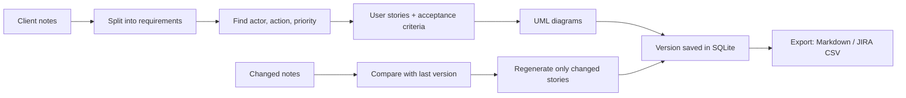

# ReqGenie

**An adaptive AI system that turns client requirements into user stories, acceptance criteria and UML diagrams.**

Course: Adaptive Software Engineering (24CI3201) · Hackathon project · Team 17, Section S11

---

## The problem

Before a team can start coding, someone has to turn messy client notes into clear user stories and diagrams. This is slow, and every time a requirement changes the work has to be redone.

## What ReqGenie does

1. You paste client requirements (one per line or sentence).
2. ReqGenie generates **user stories**, **acceptance criteria** and a **MoSCoW priority** for each one.
3. It draws **UML diagrams**: use case, class and sequence (Mermaid).
4. When requirements change, you save a **new version**. Only the affected stories are regenerated. Unchanged stories keep their IDs, and every version is stored.
5. You export to **Markdown** (diagrams render on GitHub) or a **JIRA-importable CSV**.

## How it works



The adaptive part lives in `app/diffing.py`. Each new sentence is compared with the previous version and marked **unchanged**, **modified**, **added** or **removed**. Only modified and added ones are regenerated.

## Architecture

| Part | File | Job |
|------|------|-----|
| Front end | `static/` | Plain HTML, CSS, JavaScript. Mermaid draws the diagrams in the browser. |
| API | `app/main.py` | FastAPI endpoints and static file serving. |
| Language analysis | `app/nlp.py` | Rule-based extraction of actor, action, benefit, priority, criteria. |
| Change detection | `app/diffing.py` | Finds what changed between two versions. |
| Orchestration | `app/engine.py` | `generate()` for a first version, `update()` for later versions. |
| Diagrams | `app/diagrams.py` | Builds Mermaid use case, class and sequence diagrams. |
| Storage | `app/store.py` | SQLite: projects and numbered versions. |
| Export | `app/export.py` | Markdown and JIRA CSV. |

The analyser is rule-based, so the project runs offline with no API key. To use an LLM later, replace the body of `analyse_requirement()` in `app/nlp.py`. Nothing else has to change.

## Run it

### Option 1: Python

```bash
python -m venv .venv
source .venv/bin/activate          # Windows: .venv\Scripts\activate
pip install -r requirements.txt
uvicorn app.main:app --reload
```

Open http://localhost:8000. Click **Load sample**, then **Generate new project**.

### Option 2: Docker

```bash
docker build -t reqgenie .
docker run -p 8000:8000 -v reqgenie-data:/srv/data reqgenie
```

### Try the adaptive update

1. Load the sample and generate the project (version 1).
2. Paste the text from `samples/ecommerce_changed.txt` into the box.
3. Click **Save as new version**. Open the **Changes** tab to see what was kept, edited, added or removed.

## API

| Method | Path | Purpose |
|--------|------|---------|
| POST | `/api/projects` | Create a project from `{name, text}` (version 1) |
| GET | `/api/projects` | List projects |
| POST | `/api/projects/{id}/update` | Save changed text as a new version |
| GET | `/api/projects/{id}/versions` | List versions |
| GET | `/api/projects/{id}/versions/{v}` | Get one version |
| GET | `/api/projects/{id}/export?format=md\|csv&version=N` | Download Markdown or JIRA CSV |
| GET | `/api/health` | Health check |

Interactive API docs are at http://localhost:8000/docs.

## Tests

```bash
pip install -r requirements-dev.txt
pytest -q
```

GitHub Actions (`.github/workflows/ci.yml`) runs the tests and builds the Docker image on every push and pull request.

## Example

Input:

> We need an online shop where customers can search products and pay by UPI.

Output (excerpt):

- **US-001 [Must]** As a customer, I want to search products so that I can find what I need quickly.
  - Matching results appear in under 3 seconds
  - A clear message is shown when nothing matches
- **US-002 [Must]** As a customer, I want to pay by UPI so that I can complete my purchase securely.

## Agile plan (4 sprints)

| Sprint | Goal |
|--------|------|
| 1 | Requirements, UI design, project setup |
| 2 | Input form, story and criteria generator |
| 3 | UML diagrams and change detection |
| 4 | Export, testing, final demo |

Tracked on a JIRA board; work done on Git feature branches merged by pull request.

## Git workflow

```bash
git checkout -b feature/<name>
git add . && git commit -m "Describe the change"
git push origin feature/<name>      # then open a Pull Request into main
```

## Team 17

| Name | Student ID | Area |
|------|-----------|------|
| Kurnamoni Tarun | 2420030801 | Front end and UI |
| Vatyam Trinadh Koundinya | 2420090121 | AI and back end |
| Surapaneni Chatrapath Choudary | 2420090155 | Diagrams, export and testing |

## Limitations and future work

- The rule-based analyser works best on clear sentences such as "Customers can search products". Very long or vague notes may produce generic stories.
- Possible next steps: an LLM-powered analyser, a user login, a real-time collaboration mode, and direct JIRA API sync.

## Project layout

```
reqgenie/
├── app/            backend (FastAPI)
├── static/         front end
├── tests/          pytest tests
├── samples/        example inputs
├── docs/           notes for the presentation and viva
├── Dockerfile
├── requirements.txt
└── .github/workflows/ci.yml
```
